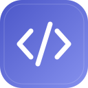

<div align="center">



<h1>HTMLViewer</h1>

<p><strong>흩어진 HTML 공부 자료를, 한곳에.</strong></p>

<p>
  <a href="https://github.com/jehee826/HTMLViewer/releases/latest">
    
  </a>
  
  
  
</p>

<p>
  <a href="https://github.com/jehee826/HTMLViewer/releases/latest">
    
  </a>
</p>

<p><sub>Windows 64비트 PC용 · 회원가입이나 로그인 없이 다운로드할 수 있습니다.</sub></p>

<p>
  <a href="#다운로드하고-시작하기">처음 사용하기</a> ·
  <a href="#html-파일-열기">HTML 열기</a> ·
  <a href="#내-자료는-어떻게-보관되나요">자료 보관</a> ·
  <a href="#새-버전으로-업데이트하기">업데이트</a>
</p>

</div>

---

**공부 자료나 문제풀이 HTML 파일을 한곳에 모아두고, 클릭해서 여는 Windows 앱입니다.**

HTML은 이름이 `.html` 또는 `.htm`으로 끝나는 웹페이지 형식의 파일입니다. 직접 만들었거나 전달받은 학습 자료를 보관함에 등록해 두면, 필요할 때 쉽게 찾아 열 수 있습니다.

|       📁 01. 파일 등록       |       🗂️ 02. 모아보기       |     ↗️ 03. 클릭해서 열기     |
| :--------------------------: | :-------------------------: | :--------------------------: |
| HTML 파일 하나를 선택하세요. | 보관함에서 찾고 분류하세요. | 별도 창에서 바로 사용하세요. |

자료는 내 컴퓨터에 저장됩니다. 앱을 사용할 때는 로그인이나 인터넷 연결이 필요하지 않습니다.

## 다운로드하고 시작하기

1. 위쪽 **다운로드 버튼**이나 **[최신 버전 다운로드](https://github.com/jehee826/HTMLViewer/releases/latest)** 링크를 누릅니다.
2. 페이지 아래쪽 **Assets(첨부 파일)**에서 이름이 **`-setup.exe`**로 끝나는 파일을 받습니다.
3. 받은 파일을 실행해 설치한 뒤, 바탕 화면이나 시작 메뉴에서 **HTMLViewer**를 엽니다.

Windows 64비트(x64) PC용입니다. 처음 사용한다면 위의 **설치형**을 선택하세요. 설치 없이 사용하고 싶다면 **`-portable.exe`**로 끝나는 파일을 받아 바로 실행할 수 있습니다. 두 파일의 앱 기능은 같습니다.

> [!NOTE]
> 현재 배포 파일에는 게시자를 확인하는 전자 서명이 없어 Windows에서 실행 경고가 표시될 수 있습니다. 파일이 위의 공식 다운로드 페이지에서 받은 것인지 확인하세요.

## HTML 파일 열기

1. 앱에서 **HTML 등록**을 누르고 보관할 HTML 파일을 선택합니다.
2. 등록한 자료가 보관함에 카드로 나타납니다.
3. **카드를 클릭하면 별도의 문서 창이 열립니다.** 문서 창을 닫아도 보관함은 그대로 남습니다.

문서에 들어 있는 글과 그림을 보고, 문제풀이 버튼 같은 기능을 사용할 수 있습니다. 사용할 수 있는 기능은 각 HTML 문서에 만들어진 내용에 따라 다릅니다.

## 자료 찾고 정리하기

- **보관함에서 찾기:** 위쪽 검색창에 자료의 제목을 입력합니다.
- **문서 안에서 찾기:** 문서 창에서 <kbd>Ctrl</kbd> + <kbd>F</kbd>를 누릅니다. 검색 결과 개수가 표시되며, <kbd>Enter</kbd>는 다음 결과, <kbd>Shift</kbd> + <kbd>Enter</kbd>는 이전 결과, <kbd>Esc</kbd>는 검색 닫기입니다.
- **자료 정리하기:** 카드 아래의 연필 버튼으로 제목과 카테고리를 바꿉니다. 왼쪽 **카테고리 관리**에서 분류를 추가하거나 수정할 수 있습니다. 카테고리를 삭제해도 자료는 **미분류**에 남습니다.
- **자료 삭제하기:** 카드 아래의 휴지통 버튼을 누릅니다. **보관함의 복사본과 해당 문서가 저장한 내용이 삭제되며, 되돌릴 수 없습니다.** 처음 등록할 때 선택했던 원본 파일은 유지됩니다.

## 언어와 저장 폴더 설정하기

왼쪽 아래의 **톱니바퀴 모양 설정 버튼**을 누릅니다.

- **언어:** 한국어 또는 English를 선택하면 바로 적용되고, 다음 실행에도 유지됩니다. 문서 검색바도 함께 바뀌며, 등록한 HTML 내용이나 자료 이름은 번역하지 않습니다.
- **보관함 저장 폴더:** **폴더 변경**을 누르고 비어 있는 폴더를 선택한 뒤 **이동**합니다. 등록한 HTML과 목록을 복사·확인한 후 이전 등록본을 정리합니다. 처음 선택했던 원본 HTML 파일은 유지됩니다.

문서의 학습 기록과 언어 설정은 앱의 기본 저장 공간에 남아 계속 사용됩니다. 위치는 설정의 **학습 기록 저장 폴더 열기**에서 확인할 수 있습니다. 다른 파일이 들어 있는 폴더에는 보관함을 덮어쓰지 않습니다.

## 어떤 HTML 파일을 사용할 수 있나요?

**글·그림·디자인·버튼 동작에 필요한 내용이 하나의 HTML 파일 안에 들어 있는 문서**를 지원합니다.

다른 폴더의 이미지·디자인·스크립트 파일이나 인터넷에서 불러오는 자료는 지원하지 않습니다. 그런 자료가 필요한 문서는 일부 내용이 보이지 않거나 버튼이 동작하지 않을 수 있습니다. 직접 만들었거나 신뢰할 수 있는 출처의 HTML을 등록해 주세요.

## 내 자료는 어떻게 보관되나요?

등록할 때 원본 파일을 **앱 전용 저장 폴더에 복사**합니다. 원본을 옮기거나 삭제해도 보관함의 자료는 유지됩니다. 원본을 나중에 수정해도 등록본에 자동으로 반영되지는 않으므로, 수정한 파일은 다시 등록해 주세요.

저장 위치는 앱 왼쪽 아래의 **저장 폴더 열기**로 확인할 수 있습니다. 문서 자체에 진행 상황이나 답안을 저장하는 기능이 있다면, 그 저장 내용도 문서별로 나뉘어 보관됩니다. 다른 컴퓨터나 클라우드로 자동 동기화되지는 않습니다.

**무설치형도 자료는 이 PC에 보관합니다. EXE 파일만 옮겨서는 자료가 함께 이동하지 않습니다.** 백업할 때는 앱을 완전히 종료하고 보관함 폴더를 복사해 두세요. 저장 폴더를 변경했다면 **학습 기록 저장 폴더도 함께 백업**해야 문서의 저장 내용과 앱 설정을 보관할 수 있습니다.

## 새 버전으로 업데이트하기

1. HTMLViewer의 보관함과 문서 창을 모두 닫습니다.
2. **[최신 버전 다운로드](https://github.com/jehee826/HTMLViewer/releases/latest)**에서 새 설치형 파일을 받습니다.
3. 설치 파일을 실행하고 **기존과 같은 설치 경로**를 사용합니다.

**기존 앱을 먼저 삭제할 필요는 없습니다. 등록한 HTML과 문서의 저장 내용은 유지됩니다.**

무설치형은 앱을 종료한 뒤 새 포터블 EXE로 교체하면 됩니다. 앱에서 새 버전을 자동으로 내려받지는 않으며, 버전별 변경 사항은 다운로드 페이지에서 확인할 수 있습니다.

---

<details>
<summary>개발자용: 소스에서 직접 빌드하기</summary>

<p>
  
  
</p>

Electron + React 기반이며, 로컬 JSON과 파일로 자료를 보관합니다. 별도 백엔드나 DB 서버는 필요하지 않습니다.

**준비:** Windows x64, Node.js 24 LTS, Git.

CMD에서 아래 명령을 실행합니다.

```cmd
git clone https://github.com/jehee826/HTMLViewer.git
cd HTMLViewer
npm ci
npm run dist
```

빌드가 끝나면 `release` 폴더에 다음 파일이 생성됩니다.

- `HTMLViewer-<버전>-x64-setup.exe`: 설치형.
- `HTMLViewer-<버전>-x64-portable.exe`: 무설치형.

개발 중에는 `npm run dev`로 관리 화면과 Electron 앱을 함께 실행할 수 있습니다.

</details>
